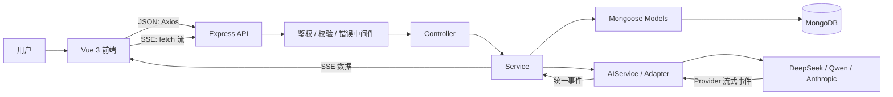
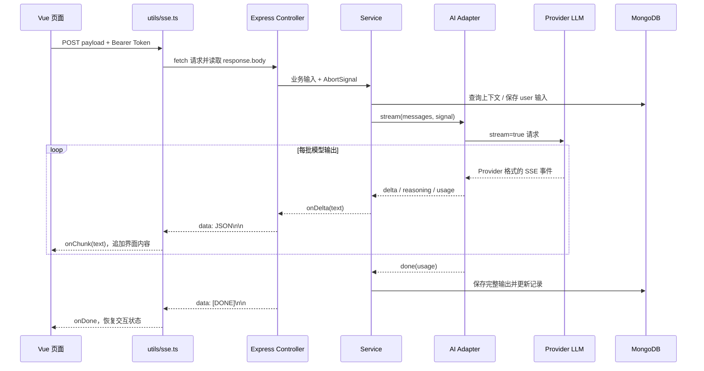

# AI 工作台项目知识地图与代码流

本文面向项目学习、排障和功能开发，按“浏览器 → API → 服务端业务 → MongoDB / LLM”的实际调用顺序说明知识点。项目功能和接口契约以 [Claude.md](Claude.md) 为准；本文重点是帮助定位代码和理解数据如何流动。

## 1. 项目总览

AI 工作台由 Vue 前端、Express API、MongoDB 和多个 LLM Provider 组成。浏览器不直接访问 MongoDB 或 LLM：普通 JSON 请求经 Axios 到 Express，流式请求使用 `fetch + ReadableStream`；服务端通过 Mongoose 操作 MongoDB，通过 AI Adapter 调用模型供应商。



## 2. 技术栈与职责

| 层              | 技术                                   | 主要职责                                 |
| --------------- | -------------------------------------- | ---------------------------------------- |
| 前端应用        | Vue 3、TypeScript、Vite                | 页面、交互、异步状态和构建               |
| 前端路由 / 状态 | Vue Router、Pinia                      | 页面切换、登录状态和跨组件状态           |
| UI / 请求       | Element Plus、Axios                    | 表单与界面组件、JSON API 请求            |
| 流式消费        | Fetch、ReadableStream、AbortController | POST SSE 消费、增量渲染、取消生成        |
| 后端            | Node.js、Express、TypeScript           | HTTP API、业务分层、中间件和错误处理     |
| 参数校验 / 安全 | Zod、JWT、bcryptjs、Helmet             | 请求验证、身份鉴权、密码哈希、安全响应头 |
| 数据层          | MongoDB、Mongoose                      | Schema、索引、查询、创建、更新和删除     |
| AI 接入         | AIService、Adapter、Provider API       | 统一调用不同模型及解析不同流协议         |

## 3. 代码目录地图

### 前端 `frontend/src`

| 目录           | 职责                                                           | 代表代码                                                                |
| -------------- | -------------------------------------------------------------- | ----------------------------------------------------------------------- |
| `api/`         | 与后端通信；普通 JSON 请求统一走 Axios                         | `http.ts`、`conversation.ts`、`prompt.ts`                               |
| `views/`       | 路由页面，组合业务组件与状态                                   | `PromptList.vue`、`ChatView.vue`、`CodeToolView.vue`、`HistoryView.vue` |
| `components/`  | 可复用展示组件，按 chat、code-tool、history、prompt 等领域组织 | `chat/`、`code-tool/`、`history/`                                       |
| `composables/` | 复用有状态的页面业务逻辑和异步流程                             | `useConversations.ts`、`useGeneration.ts`                               |
| `stores/`      | Pinia 全局状态                                                 | `auth.ts`、`prompt.ts`                                                  |
| `router/`      | 路由定义、懒加载、登录守卫                                     | `index.ts`                                                              |
| `utils/`       | SSE、变量、Markdown、导出和导航等无界面逻辑                    | `sse.ts`、`variables.ts`、`history-export.ts`                           |
| `styles/`      | 全局样式和主题变量                                             | `theme.css`                                                             |

### 后端 `backend/src`

| 目录 / 文件    | 职责                                              |
| -------------- | ------------------------------------------------- |
| `server.ts`    | 先连接 MongoDB，成功后启动 HTTP 服务              |
| `app.ts`       | Express 配置、中间件、路由挂载和错误处理顺序      |
| `routes/`      | URL、HTTP 方法、中间件与 Controller 的映射        |
| `middleware/`  | JWT 鉴权、Zod 校验、文件上传、统一错误处理        |
| `controllers/` | 读取请求参数，调用 Service，组织 HTTP / SSE 响应  |
| `services/`    | 业务规则、权限归属、数据库读写、AI 调用和数据组装 |
| `models/`      | Mongoose Schema、索引、集合模型                   |
| `schemas/`     | Zod 请求体校验结构                                |
| `services/ai/` | AI 统一接口、供应商 Adapter 和流事件解析          |
| `config/`      | 环境变量集中读取                                  |
| `utils/`       | 业务异常、统一响应和 Prompt 变量处理              |

## 4. 启动与请求基础链路

### 启动顺序

1. `backend/src/config/index.ts` 加载 `.env` 并提供端口、MongoDB URI、JWT 和 Provider 配置。
2. `backend/src/server.ts` 执行 `mongoose.connect()`。
3. 数据库连接成功后才调用 `app.listen()`；连接失败则记录错误并退出。
4. 前端由 Vite 在 `5173` 端口启动；开发代理把 `/api` 和 `/uploads` 转发到 Express 的 `3000` 端口。代理配置见 `frontend/vite.config.ts`。

### Express 通用中间件顺序

`backend/src/app.ts` 先配置 Helmet、CORS、Morgan 日志、JSON body parser 和静态上传目录，再注册业务路由，最后注册 404 与统一错误处理中间件。路由顺序重要：错误处理必须处于业务路由之后。

### 普通 JSON 请求

```text
Vue 页面 / Composable
  → frontend/src/api/<domain>.ts
  → frontend/src/api/http.ts（baseURL、注入 Bearer Token、解包 data）
  → Vite /api 代理
  → Express app.ts
  → Router → auth / validate
  → Controller → Service → Mongoose Model → MongoDB
  → { code, message, data }
  → Axios 响应拦截器返回 data
```

Axios 拦截器处理统一响应和 401；SSE 不走 Axios，因为需要读取持续到达的响应流，而是由 `utils/sse.ts` 使用 Fetch。

## 5. 前端知识点

### Vue 3 与 TypeScript

- 页面和组件使用 Vue 3 Composition API 与 `<script setup>`。
- `ref` / `shallowRef` 保存交互状态；`computed` 派生状态；`watch` 处理路由变化等副作用。
- 有状态、可复用或包含异步副作用的业务放入 composable，展示组件通过 props / emits 接收和传递数据。
- API 返回结构在 `frontend/src/types/` 定义，减少页面直接依赖未约束数据。

### 启动、路由和身份状态

- `main.ts` 注册 Pinia、Vue Router、Element Plus 后挂载 App。
- `router/index.ts` 对页面懒加载；全局守卫用 `auth` store 判断登录状态。
- `stores/auth.ts` 把 Token 和安全的用户展示信息放入 `localStorage`；退出时清理。它不是服务端鉴权的替代品，后端每个受保护 API 仍会验证 JWT。
- `api/http.ts` 在请求拦截器加 `Authorization: Bearer ...`；401 时退出登录并跳转登录页。

### JSON 与 SSE 使用不同客户端

- CRUD、列表、详情使用 Axios API 模块，便于统一 Token、错误提示和响应解包。
- 生成接口使用 `streamEndpoint()`：读取字节流、用 `TextDecoder` 处理 UTF-8、按空行切分 SSE 事件、解析 `data:`。
- `AbortController` 用于停止流；`useConversations.ts` / `useGeneration.ts` 另用递增 ID 判断回调是否属于当前请求，避免切换会话或启动新生成后旧回调污染界面。
- Markdown 输出由 `utils/markdown.ts` 渲染；复制、导出由 `utils/clipboard.ts`、`history-export.ts`、`code-tool-export.ts` 等工具负责。

### 浏览器本地状态与服务端状态

- 登录 Token、主题偏好、代码工具草稿等属于浏览器本地状态。
- 会话、消息、Prompt、调用记录、代码工具执行记录、用户设置属于服务端数据。
- 主题由 `composables/useTheme.ts` 写入 `localStorage`；鲸鱼桌宠交互由 `useWhalePet.ts` 管理，不作为 MongoDB 业务数据。

## 6. 后端分层与通用知识点

### Route → Middleware → Controller → Service → Model

- **Route**：定义 API 路径和中间件顺序，不承载业务查询。
- **Middleware**：`auth` 从 Bearer Token 验证身份并写入 `req.user`；`validate(schema)` 用 Zod 校验请求体。
- **Controller**：把 Express Request 转成 Service 参数；普通接口返回 `ok(data)`，SSE 接口管理响应头、事件写入和连接关闭。
- **Service**：实施权限和业务规则、执行 Mongoose 查询、调用 AIService，并转换 DTO。
- **Model**：声明字段、校验、默认值、时间戳和索引。

新增接口通常按以下顺序开发：Schema → Route → Controller → Service → Model（如需新数据）→ 前端 API / 页面 → 验证。

### 鉴权、密码和错误

- 注册：Zod 校验 → 查询用户名 → `bcrypt.hash(password, 10)` → 创建 User。
- 登录：显式 `.select('+password')` 取出默认隐藏的密码哈希 → `bcrypt.compare()` → 签发 JWT。
- User 的 password、用户自定义 Provider API Key 使用 `select: false`，普通查询不会返回这些字段。
- `AppError` 表示可预期业务错误；统一错误处理中间件将它转换成 `{ code, message, data: null }`。未知错误只返回通用 500，不把堆栈发给客户端。
- 资源查询同时带 `userId`，例如 `findOne({ _id, userId })`；不存在和越权统一返回 404，避免暴露他人资源是否存在。

## 7. MongoDB / Mongoose 数据知识

MongoDB 是文档数据库；Mongoose Model 将 TypeScript 服务中的对象映射到集合。Schema 配置 `timestamps: true` 的集合会自动维护 `createdAt`、`updatedAt`。MongoDB 本身不会自动替应用做关系级联删除；相关清理由 Service 显式完成。

### 集合及逻辑关系

| Model / 集合     | 关键字段                                                                  | 关系 / 用途                                    |
| ---------------- | ------------------------------------------------------------------------- | ---------------------------------------------- |
| `User`           | username、password、nickname、avatar、Provider API Keys                   | 用户主体；密钥字段默认不查询返回               |
| `Prompt`         | userId、name、content、variables、currentVersion                          | 用户拥有的 Prompt 当前版本                     |
| `PromptVersion`  | promptId、version、content、variables、createdBy                          | Prompt 内容快照；通过 ObjectId 逻辑关联 Prompt |
| `ChatRecord`     | userId、promptId、promptVersion、model、input、output、tokenUsage、status | Prompt 工作台每次 AI 调用快照                  |
| `ChatSession`    | userId、title、model                                                      | 多轮对话会话                                   |
| `ChatMessage`    | sessionId、role、content、tokenUsage                                      | 会话中的用户消息或 assistant 消息              |
| `CodeToolRecord` | userId、toolKey、model、input、output、language、status                   | 代码工具每次运行记录                           |

逻辑关系：`User 1:N Prompt / ChatSession / ChatRecord / CodeToolRecord`；`Prompt 1:N PromptVersion / ChatRecord`；`ChatSession 1:N ChatMessage`。除 Schema 中明确声明的 ObjectId 外，userId 以字符串保存；这些是应用层关系，不是 MongoDB 外键约束。

### 常见数据库操作

| Mongoose 操作                             | 项目用途示例                                   |
| ----------------------------------------- | ---------------------------------------------- |
| `Model.create()`                          | 注册用户、新建 Prompt/版本、保存消息和调用记录 |
| `findOne({ _id, userId })`                | 查询并同时校验资源归属                         |
| `findByIdAndUpdate(..., { new: true })`   | 更新用户资料或 Provider 配置并取回更新后文档   |
| `findOneAndDelete()` / `deleteMany()`     | 删除用户资源及关联记录                         |
| `sort({ createdAt: 1 })`                  | 按时间正序还原多轮消息                         |
| `skip()` / `limit()` / `countDocuments()` | Prompt 和调用历史分页                          |
| `.lean()`                                 | 历史聚合只读查询，减少 Mongoose Document 开销  |
| `$in`                                     | 一次查出多个会话的消息，避免逐个会话查询       |

Prompt、会话、记录上的复合索引主要服务于用户隔离后的时间排序、Prompt 搜索和关联消息排序；索引定义位于各自 `models/*.model.ts`。

### 数据持久化边界

- Prompt 创建会分别写 Prompt 与 v1 版本；更新内容时先更新当前 Prompt，再创建新版本。
- 删除 Prompt 时并发清理 Prompt、版本和调用记录。
- 这些多文档流程当前没有使用 MongoDB Transaction；若要求任何一步失败都整体回滚，需要增加事务并确认 MongoDB 部署支持事务。
- 头像文件存磁盘目录 `uploads/`，MongoDB 只保存 `/uploads/<文件名>` 路径，不保存图片二进制。

## 8. 核心业务代码流

### 8.1 注册 / 登录

```text
Login.vue
  → api/auth.ts → Axios
  → POST /api/auth/register 或 /login
  → auth.routes.ts → Zod schema → auth.controller.ts
  → auth.service.ts
      注册：User.findOne → bcrypt.hash → User.create
      登录：User.findOne.select('+password') → bcrypt.compare → jwt.sign
  → 返回 token + User DTO
  → auth store.setAuth 写 localStorage
  → Router 守卫允许访问受保护页面
```

代码：`frontend/src/views/Login.vue`、`frontend/src/stores/auth.ts`、`backend/src/routes/auth.routes.ts`、`backend/src/services/auth.service.ts`。

### 8.2 Prompt CRUD、变量、版本

```text
PromptList / PromptWorkspace
  → frontend/src/api/prompt.ts
  → /api/prompts
  → prompt.routes.ts（auth + Zod）
  → prompt.controller.ts → prompt.service.ts
  → Prompt / PromptVersion 查询或写入 MongoDB
```

- 保存 Prompt 时，`extractVariables(content)` 提取 `{{name}}` 变量并存入 `variables`。
- 首次创建写当前 Prompt 和版本 v1。
- 更新时比较旧、新 content：内容变化才递增 `currentVersion` 并创建新快照；仅改名称或描述不生成版本。
- 恢复旧版本不是覆盖历史，而是把旧内容写回当前 Prompt，并创建一个更高版本号的新快照。
- 所有读写通过 `userId` 限制为当前用户的数据。
- `GET /api/prompts/export` 导出 JSON；`POST /api/prompts/import` 用 Zod 校验格式后逐条创建 Prompt。

代码：`backend/src/utils/variables.ts`、`backend/src/services/prompt.service.ts`、`backend/src/models/prompt.model.ts`、`backend/src/models/prompt-version.model.ts`。

### 8.3 Prompt 调用与记录

```text
PromptWorkspace 的运行操作
  → api/chat.ts
  → POST /api/chat 或 /api/chat/stream
  → chat.routes.ts（auth + chatSchema）
  → chat.controller.ts
  → chat.service.ts
      prepareChat：校验 Prompt 归属、变量完整性、渲染模板
      AIService：按 model 选 Adapter
      ChatRecord：保存输入/输出/版本/模型/耗时/Token/status
```

流式接口先执行 `prepareChat()`，预检通过后才发送 SSE 响应头，因此 Prompt 不存在、变量缺失或 API Key 未配置时仍能返回普通 JSON 错误。流开始后的异常则以 SSE error 事件返回。

### 8.4 AI 多轮对话

```text
useConversations.send()
  → streamEndpoint('/api/conversations/:id/stream')
  → conversation.routes.ts（auth + messageSchema）
  → conversation.controller.stream()
  → conversation.service.streamMessage()
      owned(userId, id)
      ChatMessage.find({ sessionId }).sort({ createdAt: 1 })
      先保存 user 消息，再附加到上下文
      AIService.stream(messages, signal)
      聚合输出并转发 delta
      未取消时保存 assistant 消息与 Token 用量
  → [DONE] → 前端退出 streaming 状态并刷新会话列表
```

新建会话只创建 `ChatSession`；第一次发送时按首条用户消息设置标题。历史上下文由 `ChatMessage` 按时间排序恢复。用户输入先落库，所以即便 LLM 调用失败，输入仍会保留；当前聊天流在取消时不保存不完整的 assistant 消息。

代码：`frontend/src/composables/useConversations.ts`、`frontend/src/utils/sse.ts`、`backend/src/controllers/conversation.controller.ts`、`backend/src/services/conversation.service.ts`。

### 8.5 代码工具与推理摘要

```text
CodeToolView / useGeneration
  → POST /api/code-tools/:key/stream
  → code-tool.routes.ts（auth + codeToolSchema）
  → code-tool.controller.stream()
  → code-tool.service.streamTool()
      toolKey 查固定工具 Prompt
      system 指令 + 目标语言 + 用户代码
      AIService.stream
      delta / reasoning 分别推给前端
      CodeToolRecord 保存结果和 success/error/aborted 状态
  → GenerationOutput 展示；GenerationActions 复制或导出 Markdown
```

推理字段只消费 Provider 明确返回的公开摘要，不代表获取或还原模型隐藏思维链。导出由浏览器使用 Blob 生成 Markdown 文件，不需要再次调用后端。

代码：`backend/src/constants/code-tools.ts`、`backend/src/services/code-tool.service.ts`、`frontend/src/composables/useGeneration.ts`、`frontend/src/utils/code-tool-export.ts`。

### 8.6 统一历史

`GET /api/history` 由 `history.service.ts` 并行查询当前用户的 `ChatSession` 和 `CodeToolRecord`，再用 `$in` 批量读取相关 `ChatMessage`，统一映射成聊天或代码工具条目；关键词搜索、排序、分页结果再返回前端。

历史详情的“继续对话”导航到原 `conversationId`；“再次运行”把代码工具的输入、模型和工具类型临时放入 `sessionStorage`，代码工具页面读取后恢复表单。复制、Markdown 导出在前端完成。

代码：`backend/src/services/history.service.ts`、`frontend/src/views/HistoryView.vue`、`frontend/src/utils/history-export.ts`。

### 8.7 Provider 配置与密钥

```text
ProviderSettings.vue → /api/providers
  → provider.routes.ts（auth + Zod）
  → provider.service.ts
      用户自定义 Key 存 User 的 select:false 字段
      返回 configured / hasCustomKey / maskedKey，不返回明文
  → 调用模型时 getApiKeyForModel(userId, model)
  → 优先传用户 Key；没有时由 Adapter 使用服务端 .env 默认 Key
```

模型注册表见 `backend/src/services/ai/ai.service.ts`。增加供应商通常需要新增 Adapter，并将模型映射注册到 AIService；业务 Service 依赖统一 `chat()` / `stream()` 接口。

## 9. SSE 与 LLM 的完整生命周期

浏览器到后端、后端到 Provider 是两条 HTTP 流。LLM 负责生成文本；SSE 负责按事件传输生成过程；Adapter 负责把不同 Provider 的协议归一。



关键细节：

- SSE 帧以空行分割，网络读取边界不保证和 SSE 帧边界一致，所以必须缓冲不完整片段；UTF-8 字符也可能跨多个网络块，由 `TextDecoder` 处理。
- 前端检查 `Content-Type`、JSON 解析错误、服务端 error 事件和异常断流；正常结束标记为 `[DONE]`。
- Controller 用 `AbortController` 把浏览器断开传给 Adapter 的上游 `fetch`；代码工具 composable 用 generation ID 忽略旧请求迟到的回调。
- OpenAI 兼容 Adapter 解析 `data:` / `[DONE]`；Anthropic Adapter 解析 `content_block_delta`、`message_stop` 等原生事件，再统一转换内部事件。
- Token 用量可能在流结束事件中才返回；OpenAI 兼容请求显式请求 `include_usage`。
- 取消不等于保证 Provider 立即停止计费；还取决于供应商处理上游断连的行为。

核心代码：`frontend/src/utils/sse.ts`、`backend/src/controllers/chat.controller.ts`、`backend/src/controllers/conversation.controller.ts`、`backend/src/controllers/code-tool.controller.ts`、`backend/src/services/ai/openai-client.ts`、`backend/src/services/ai/anthropic-client.ts`。

## 10. API 路由地图

所有业务路由挂载在 `backend/src/app.ts`；除注册、登录和健康检查外，业务接口使用 JWT 鉴权。

| 路由前缀             | 能力 / 代表接口                                                              |
| -------------------- | ---------------------------------------------------------------------------- |
| `/api/health`        | 健康检查                                                                     |
| `/api/auth`          | `POST /register`、`POST /login`、`GET /me`、`PATCH /profile`、`POST /avatar` |
| `/api/prompts`       | Prompt 列表/CRUD、版本列表/恢复、导入/导出                                   |
| `/api/chat`          | Prompt AI 单次调用 `POST /`、流式调用 `POST /stream`                         |
| `/api/chat-records`  | Prompt 调用记录列表、详情、删除                                              |
| `/api/providers`     | Provider 状态查询和用户 Key 更新                                             |
| `/api/conversations` | 会话 CRUD、`POST /:id/messages`、`POST /:id/stream`                          |
| `/api/code-tools`    | 工具列表、`POST /:key/run`、`POST /:key/stream`                              |
| `/api/history`       | 对话与代码工具统一搜索/筛选/分页                                             |
| `/uploads`           | 头像静态文件访问                                                             |

具体请求体、参数和响应契约见 `Claude.md` 第 8 章及 `backend/src/schemas/`。

## 11. 安全与工程边界

- 不信任前端传来的 userId：用户身份以已验证 JWT 中的 `req.user.userId` 为准。
- 资源访问查询带 userId；ObjectId 先校验格式，越权与不存在统一处理。
- 密码使用 bcrypt 哈希；用户 API Key 默认 `select: false`，API 只回脱敏信息。
- Provider 默认 Key 仅从后端 `.env` 读取，不发送到浏览器；生产环境必须更换默认 JWT secret。
- Zod 负责请求数据边界；Mongoose Schema 负责持久化结构与字段约束，两者目标不同，不能互相替代。
- 头像上传使用 MIME 白名单、2 MB 限制、随机文件名，文件落盘而非存数据库。
- 多文档更新目前未使用事务；长对话历史目前会全部组装给模型，随着会话变长会增加 Token 成本和上下文限制风险。
- 历史服务已批量取消息，但结果仍在内存中合并和分页；大数据量时应改为数据库侧聚合/分页。

## 12. 本地开发与验证

```bash
# 项目根目录安装依赖
npm install --prefix backend
npm install --prefix frontend

# 后端
npm run dev --prefix backend

# 前端
npm run dev --prefix frontend

# 验证
npm test --prefix frontend
npm run typecheck --prefix frontend
npm run build --prefix frontend
npm run build --prefix backend
```

前端 Node 原生测试位于 `frontend/tests/`；当前后端 package scripts 提供 dev/build/start，尚未配置独立的后端自动化测试脚本。可通过 `scripts/qa-server.mjs` 使用本地 MongoDB 和模拟 AI 做隔离联调，操作前先阅读根目录 `README.md` 的安全说明。

## 13. 推荐学习顺序

1. 先读 `frontend/src/main.ts`、`router/index.ts`、`api/http.ts`，理解应用启动、鉴权路由和 JSON 请求。
2. 沿登录流程读 `auth.routes.ts` → `auth.controller.ts` → `auth.service.ts` → `User` Model。
3. 沿 Prompt 保存流程读 schema、route、controller、service 和 Prompt / PromptVersion Model。
4. 读 `chat.service.ts` 的 Prompt 预检和 AI 调用，再读 AIService 与一个 Adapter。
5. 读 `useConversations.ts` → SSE util → conversation Controller/Service → Adapter，理解流式请求、取消和落库。
6. 最后看 `code-tool.service.ts`、`history.service.ts`，理解不同记录模型如何聚合和复用。
